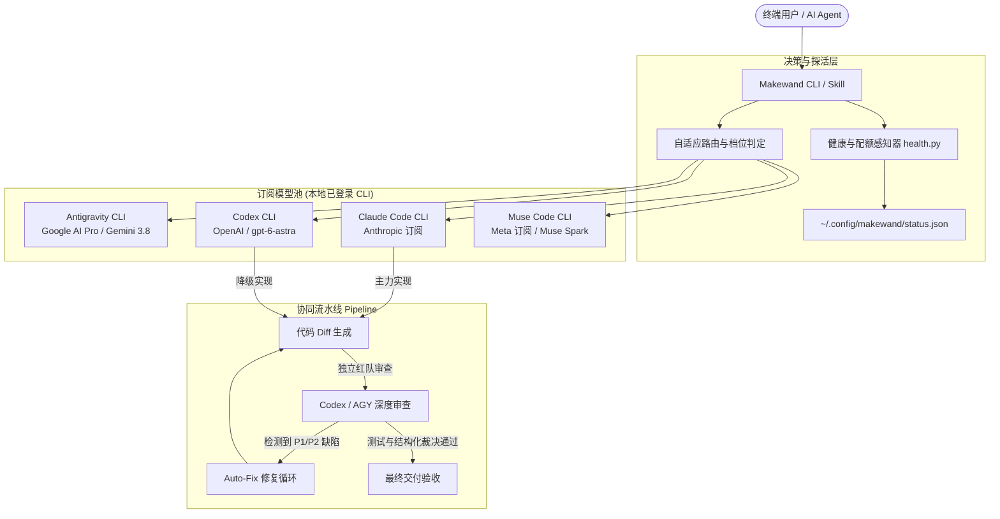

# Makewand (魔杖) v3.2.0

> **多模型编程订阅联合调度与红队自愈体系** (Unified Multi-Model Subscription Orchestrator)  
> 官方网站：[https://makewand.org](https://makewand.org) · 备用镜像：[https://makewand.com](https://makewand.com)  
> 统合调用本机 **Antigravity (Google AI Pro)**、**Claude Code**、**Codex CLI (OpenAI)**、**Grok Build**、**Muse Code** 与其他已配置工具，提供订阅优先调度、显式付费 API 策略、跨模型审查、自愈回环与候选比较。

```bash
# 🚀 官方一键快速安装
curl -fsSL https://makewand.org/install.sh | bash
```

---

## 🌟 核心特性 (Key Features)

- **🌐 官方网站与文档中心**：托管于 Cloudflare Pages 全球边缘网络（[makewand.org](https://makewand.org) / [makewand.com](https://makewand.com)），提供交互式终端模拟器与完整手册。
- **🔌 全生态工具自适应拓扑**：根据已安装工具、显式启用配置和健康缓存选择实现与审查引擎。只有一个工具时使用单独的只读复审调用，仍需测试及有效裁决。
- **💰 明确的 API 费用策略**：默认 `subscription_only`，禁止 Makewand 直接调用云 API，即使环境中已有 API key 也不会自动转为付费回退。设置 `MAKEWAND_API_POLICY=allow_paid` 或配置 `"api_policy": "allow_paid"` 才允许按量计费的 API 与回退；订阅 CLI 限额、登录失效或未安装时，也只有在 `allow_paid` 下才转用已配置的 API key，否则这类引擎不算可用。`makewand status` 展示当前策略。官方 CLI 自身的计费模式、订阅配额和本机资源消耗仍由相应工具及配置决定。
- **⚡ 额度感知与自适应降级 (Quota-Aware Routing)**：
  - Python 状态看板使用缓存、本地调用估算和 CLI 报告，不将估算当成官方剩余额度；Go `quota` 提供支持工具的官方额度读取。
  - 限额与登录失效只依据各 CLI 自己打印的消息判定（`makewand/cli_message_catalog.json`，Go 路由器内嵌同一份），模型回答、工具输出或提示回显中的相同字样不算。
  - 在已启用且可用的候选引擎间回退；额度、认证或审查失败可能阻止交付。
- **🛡️ 跨模型独立红队审查 (Cross-Model Review)**：
  - 审查在只读沙箱中运行，优先采用与实现者不同的引擎。
  - 审查必须给出结构化 `MAKEWAND_VERDICT`，并与经过测试的具体产物绑定。
- **🔄 自愈修复闭环 (Auto-Fix Loop)**：
  - 审查若发现 `[P1]`（高危）、`[P2]`（中危）、死锁或竞态缺陷，在配置的修复次数和时间预算内重派实现及复审；测试失败、裁决缺失或产物改变会阻止交付。
- **🏁 双模型并发隔离竞速 (Race Mode)**：
  - `makewand race "<任务>"` 在临时隔离沙箱中并行派发两组模型，统计耗时与代码质量，由可用裁判输出结构化采纳裁决。默认保留 A/B 候选，显式 `merge` 才生成混合候选 M。
- **🌲 非 Git 目录弹性容灾**：未初始化 Git 的工程自动构建轻量级影子跟踪树，彻底解决常规工具依赖 Git 导致的崩溃。
- **🚀 无头执行与跨平台沙箱约束**：写入任务在必需的 Bubblewrap (bwrap) 沙箱内运行官方 CLI；沙箱不可用时遵循 fail-closed 拒绝执行。bwrap 沙箱依赖 Linux 内核命名空间。没有沙箱时（如 macOS），**包括只读审查 `makewand review` 在内的所有 provider 调用**都需要显式配置 `MAKEWAND_UNSAFE_HOST_EXEC=1` 并完成一次交互确认（所有宿主执行审计至 `unsafe_exec_audit.jsonl`），或改在装有 bwrap 的 Linux 容器/虚拟机中运行。Go 的 Strength1 候选仍需人工确认。
- **📡 实时流式输出**：支持 `--stream` 参数，带模型专属色彩前缀逐行流式呈现。

---

## 🏗️ 架构拓扑 (Architecture)



---

## 📦 安装与配置 (Installation)

### 快速安装
```bash
cd path/to/makewand
./scripts/install.sh
```
源码安装需要 Git、Python 3.9+ 和 `go.mod` 指定的 Go 工具链。安装器冻结 Go/Python 构建输入，在独立版本目录中编译、检查版本及公共命令，然后原子切换 `current` 与 `~/.local/bin/makewand`。失败保留原安装，并保留 `previous` 供回退；同时建立兼容的 `trio` 软链接。安装目录（默认 `~/.local/bin`，可用 `MAKEWAND_BIN_DIR` 指定）不在 `PATH` 中，或 `PATH` 上更早的位置有另一个 `makewand` 时，安装器最后会打印需要加入 shell 配置（如 `~/.zshrc`、`~/.bashrc`）的 `export PATH=...` 行，加入后打开新终端即可。

预编译 Release、Homebrew 和 Scoop 安装包含 Go CLI 与同版本 Python 引擎；运行时需要 Python 3.9+。手动解包时须将整个目录一起安装，保留二进制旁的 `lib/`。Homebrew/Scoop 会声明 Python 依赖。供应商 CLI 与项目测试工具需要单独安装；Makewand Python 引擎本身仅使用标准库。

> **版本与安全加固**：v3.2.0 之后加入的保护（#75、#80–#85，例如 `bwrap` 只从 root 拥有的系统目录解析、宿主 provider 目录不再可写挂载、Homebrew 包装脚本不再写死 `PATH`）已在 `master` 源码中，随 v3.3.0 发布；目前的 v3.2.x 预编译包、Homebrew 与 Scoop 没有这些保护。v3.3.0 发布前需要它们时，请用上面的源码安装。详见 [SECURITY.md 发布状态](SECURITY.md#release-status--发布状态)。

供应商启停策略对 Go/Python 入口共同生效，禁用也阻止该工具的探测和额度读取。Claude、Gemini 和 OpenAI 的 API 参数按环境变量、`api_keys.json`、`config.json`、默认值的顺序读取；付费调用仍需显式启用 `allow_paid`。详见[共享配置契约](docs/EXECUTION_CONTRACT.md#shared-provider-configuration)。

代理默认值对 Go/Python 的 provider CLI、沙箱和 API 路由共同生效。编辑 `~/.config/makewand/config.json`（或 `MAKEWAND_CONFIG_DIR/config.json`），保留其他配置，例如：

```json
{"proxy": {"default": "http://proxy.example:8080", "no_proxy": "localhost,127.0.0.1,.internal.example"}}
```

`MAKEWAND_DEFAULT_PROXY`、`MAKEWAND_DEFAULT_NO_PROXY` 分别覆盖这两个字段，空字符串可禁用相应默认值。仅当调用方完全没有 `HTTP_PROXY`、`HTTPS_PROXY`、`ALL_PROXY` 及其小写变量时，才补齐六个代理变量；已有变量（包括空值）原样保留。仅在补默认代理时，且调用方没有任一大小写 `NO_PROXY`，才补齐 `NO_PROXY`/`no_proxy`。没有配置默认代理时不加代理，也没有内置本机端口。离线沙箱不补默认代理。

Gemini/agy 默认遵循代理，只有显式设置 `MAKEWAND_GEMINI_BYPASS_PROXY=1` 才向大小写 `NO_PROXY` 追加 Google 域名；兼容开关 `MAKEWAND_GEMINI_USE_PROXY=1` 优先于绕过开关。Google API 路由也遵循此规则。`makewand status`（含 `--json`）显示代理来源：环境变量、配置默认值或无；状态只显示来源，不输出代理 URL，避免泄露用户名密码。Go 入口的 `setup` 同样显示来源。默认值不会写入宿主环境或配置文件。

`MAKEWAND_QUOTA_RESERVE_PERCENT` 设置官方剩余额度的保留阈值，默认 `8`（百分比）；例如仅对一次命令设置 `MAKEWAND_QUOTA_RESERVE_PERCENT=4 makewand ...`。只接受有限数值 `0`–`100`，低于阈值时阻止自动派发；`0` 也不会放行已耗尽额度。无效设置会显示警告并回退到 `8`，不会清除实际限流或认证失败；账号关联及官方数据有效期仍照常校验。显式设置时，Codex 精确的剩余百分比使用同一阈值；模糊的低额度警告只有新鲜、同账号官方证据确认足够时才放行，真实限流仍优先。该设置不增加订阅额度，也不启用付费 API。

---

## 💻 命令行用法速查 (CLI Reference)

### 1. 订阅健康状态与额度看板
```bash
# 查看健康缓存与额度来源（不会主动调用模型）
makewand status
makewand quota

# 显式发起探活（claude/codex/muse/grok 消耗真实订阅调用；agy 只在有未过期的失败记录或额度限制时做一次真实调用）
makewand probe
```

已启用的引擎都处于错误状态，或处于限额、需重新登录、未安装且没有 API 策略允许转用的 API key 时（默认的 `subscription_only` 下 key 从不转用），任何任务都不派发，并逐个列出原因（退出码 11）。用 `--provider X` 指定的引擎在工作区准备与任何派发之前先检查：不可用时同样不派发（退出码 11，`Requested engine X is not usable: <原因>`）；可用时即使其他引擎都不可用也会运行，审查请求则只由它审查。

### 2. 动态模型发现
```bash
# 自动探测系统配置文件中记录的最新模型版本
makewand models
```

### 3. 全自动联合编码流水线
```bash
# 执行端到端实现 + 跨模型审计 + 自愈回环
makewand run "在当前目录编写一个支持重试与指数退避的 HTTP 请求客户端"

# 指定工作目录并启用实时流式输出
makewand run "重构用户认证模块" --cwd /path/to/repo --stream

# 指定推理档位 (fast / standard / deep)
makewand run "排查并发线程安全" --tier deep

# 保持已有验收测试的内容与权限；任务在隔离工作树完成
makewand run "修复解析器" --protect tests/test_parser.py
```

`--protect` 可重复指定相对路径，也适用于 `race` 和 `apply`。成功的受保护流水线提供带校验的 `apply_delivery.sh`；候选应用的 `--force` 不能绕过文件保护。详见 [执行约定](docs/EXECUTION_CONTRACT.md#protected-task-files)。

本地测试在沙箱内运行，Python 用 pytest 还是 unittest 由沙箱内能否导入 pytest 决定（宿主解释器能导入、沙箱里看不到的用户级 pytest 不算）。测试无法运行——项目配置了 pytest 但沙箱内导入不了、pytest 或 unittest 以退出码 5 结束（没有收集到或执行任何测试）、输出 pytest 自身的导入错误——时结论为未验证（退出码 11）；测试总时间预算先耗尽时为超时（退出码 16）。两者都不算测试失败，不进入自动修复；但此前已有测试套件报告失败、或测试运行修改了待交付输入时，仍按失败处理。`race` 中这样的候选没有测试证据、不能胜出：没有候选通过测试时，比赛以未验证（退出码 11）结束，有候选的测试关卡超时则为超时（退出码 16）。详见 [验证契约](docs/VERIFICATION_CONTRACT.md#python-pipeline-and-race-candidates)。

宿主模式下，审查 diff 之外的改动——新建或改动被忽略的文件、二进制或可执行产物、`.env*`/`.envrc`/`*.pth`/`sitecustomize.py`、子模块或嵌套仓库中的文件、本检出（及其子模块）私有 hooks 目录中的新 hook——会阻止交付并回滚（退出码 11）；新 hook 移入 `rejected_*/quarantine/git-hooks/` 并附 `mv` 恢复命令，链接工作树等共享的 hooks 目录只报告。测试运行在工具默认位置生成的测试产物会被删除，不进入审查与交付。没有备份的既有文件（依赖与缓存目录、超过备份上限的文件）在任务开始时计算 SHA-256 摘要与抽样指纹，上限为 `MAKEWAND_FINGERPRINT_FILE_LIMIT`（单文件，默认 64 MiB）、`MAKEWAND_FINGERPRINT_TOTAL_LIMIT`（总量，默认 512 MiB）与 `MAKEWAND_FINGERPRINT_SECONDS`（默认 20 秒），交付核查与回滚核验同样受这些上限约束；内容无法确认的文件按“无法确认”阻断，并提示应调高哪个上限。详见 [验证契约](docs/VERIFICATION_CONTRACT.md#python-host-mode-delivery)。

`makewand plan "<目标>"` 把目标拆成 DAG 子任务。多阶段 DAG 在一份私有暂存副本中逐阶段执行，累积结果作为候选 `dg_…` 的 `A` 只交付一次：工作区安全时自动应用，否则给出确切的 `makewand apply` 命令；只读子任务审查此前的累积改动，其写入一律丢弃。原生 Windows 上多阶段 DAG 拒绝执行（请用 WSL2）。暂存区绑定的清单受 `MAKEWAND_WORKSPACE_SNAPSHOT_MAX_FILES`、`MAKEWAND_WORKSPACE_SNAPSHOT_MAX_BYTES`、`MAKEWAND_WORKSPACE_SNAPSHOT_TIMEOUT_SECS`（默认 100,000 个文件、512 MiB、每份 10 秒）约束，超限的仓库在复制任何内容之前即被拒绝（未验证，退出码 11），并提示超出的上限；未跟踪且被 gitignore 的文件（数据、日志等）不计入。详见 [验证契约](docs/VERIFICATION_CONTRACT.md#multi-stage-dag-delivery)。

### 4. 独立代码审查
```bash
# 针对当前目录未提交的 git diff 实施红队安全审查
makewand review
```

审查 diff 超过 256 KiB（用 `MAKEWAND_REVIEW_DIFF_MAX_BYTES` 调整，单位字节）时不做截断审查，结论为未验证（退出码 11），完整补丁保存为可直接 `git apply` 的 `unverified.patch`。超过 31 KiB 的审查提示不交给 agy（它只能分页读取提示文件），流水线改由下一位可用的审查方接替；cursor、copilot 等占位引擎从不审查；本地模型的只读回答须由 token 计数证明读到了完整提示，否则为未验证。详见 [执行约定](docs/EXECUTION_CONTRACT.md#reviewer-capacity)。

### 5. 双模型并发竞速模式
```bash
# 两位选手并行实现，由可用裁判评审；工作区保留候选供检查
makewand race "实现一个快速排序函数 quick_sort(arr) 并写测试用例验证"
makewand inspect <race-id> --candidate A
makewand apply <race-id> --candidate A

# 可选混合候选：完整三方合并、测试、独立复审，然后应用
makewand merge <race-id>
makewand review --race-id <race-id> --candidate M
makewand apply <race-id> --candidate M
```

claude、codex、grok、muse、local、agy 中任意两个不同的已启用且健康的引擎都可组成一对选手（agy 只要不处于已知失败状态），`run --workflow race --provider X` 指定 X 为选手 A；无法组队时列出每个引擎的原因。裁决行必须带本任务的随机 nonce（`MAKEWAND_RACE_VERDICT_<nonce>`），候选 diff 中回显的裁决行无效，不带 nonce 的裁决行在任何环境下都无效。率先通过测试的选手（Winner-Take-All）须经另一提供方的只读复审通过才算胜出；裁判选中与自己同一提供方的候选时，同样需要另一提供方复审。裁判与复审方都优先选择与双方选手都不同的提供方，复审方没有这样的选择时由另一位选手担任，从不是胜者自己。

### 6. 带预算安全搜索 (避免冷归档与大库 I/O 卡死)
```bash
makewand search "def safe_search" --cwd /path/to/project
```

### 7. Bubblewrap 物理进程沙箱隔离执行
```bash
# 隔离运行单元测试 (只读根目录、凭据自动脱敏、仅工作区可写)
makewand sandbox python3 -m pytest tests/

# 阻断外网访问执行构建/测试
makewand sandbox --no-net go test ./...
```
> **跨平台隔离说明**：Bubblewrap 物理沙箱依赖 Linux 内核命名空间。没有沙箱时（如 macOS），所有 provider 调用（包括只读审查）都遵循 fail-closed 拦截，并给出指引：在装有 bwrap 的 Linux 容器/虚拟机中运行，或显式 `MAKEWAND_UNSAFE_HOST_EXEC=1` 确认授权（附审计记录）。bwrap 只从 root 拥有的系统目录解析，装在其他位置时用 `MAKEWAND_BWRAP_PATH` 指定。

> **依赖安装网络**：Go 候选验证的依赖安装（含 Rust 检查前的 `cargo fetch`）不共享宿主网络命名空间。找到可信的 `slirp4netns`、`nsenter`、`ip` 时只能访问公网（私网、回环、链路本地与云元数据、组播及本机地址在命令运行前即被路由屏蔽，可选的 `tc`/`nft` 再过滤组播与 IPv6），否则只有回环网络；这些工具不在 root 拥有的系统目录时，用 `MAKEWAND_SLIRP4NETNS_PATH`、`MAKEWAND_NSENTER_PATH`、`MAKEWAND_IP_PATH`、`MAKEWAND_TC_PATH`、`MAKEWAND_NFT_PATH` 指定。私网或本机回环上的镜像与代理按设计不可达。安装失败只有在 makewand 自己的连通性检查（离线时为项目文件）确认注册表不可达时才算环境问题，此时 TUI 跳过测试、不扣分。详见 [SECURITY.md](SECURITY.md#dependency-installs--依赖安装)。

### 8. 单模型直接透传调用
```bash
makewand agy "总结当前项目的架构优势"
makewand codex "分析这段代码的死锁风险"
makewand claude "编写测试用例"
makewand muse "检查系统配置项"
```

### 9. 自动派活选型：route / mark / outcome

```bash
# 为子任务挑选工具、模型与推理深度，打印可照抄的派活命令（只读本地缓存与成绩账本，不调用模型）
makewand route implement normal --self claude
makewand route review hard --self claude --not codex --json

# 派活遇到 429 或额度用完：标记该工具，到期前 route 跳过它
makewand mark codex 6h --reason 429

# 验收后记录成绩，route 据此调整之后的排序
makewand outcome codex 2 implement pass --model gpt-6-astra --effort high
```

`route <类型> <难度>` 的类型为 review、implement、test、research、doc，难度为 mechanical、normal、hard。它在完整的模型 × 推理深度目录中，从够用的最便宜档位（1–3）起选：跳过 `~/.config/mw-hub/policy`（或 `MW_HUB_POLICY`）里暂停中的工具、`mark` 标记期内的工具，以及官方周额度达到阈值的 codex/claude（默认 90%/85%），再按 `outcome` 记录的通过率用 Thompson 采样排序。`--self <工具>` 把与你同家的候选排在最后，`--not <工具>` 排除与它同家族的候选（审查时传实现方），`--tier N` 指定起始档，`--risk high` 从最强档起，`--simple` 只用精简三档表，`--json` 输出全部候选；验收不过时按输出末尾的提示升一档。派活命令自带的时限见下文“调用与资源预算”。

`mark <工具> <时长>` 的时长为 d/h/m/s 组合（如 `6h`、`93h17m`、`2d`，最长 365 天），`--reason` 可选。`outcome <工具> <档> <类型> pass|fail` 可附 `--model`、`--effort`、`--seconds`、`--calls`。标记与成绩保存在 makewand 私有状态目录的 `routing/` 下（`MAKEWAND_ROUTING_DIR` 可改）。三个命令都不调用模型；在 provider worker（`MAKEWAND_PROVIDER_WORKER=1`）内被拒绝。

### 10. 统一模式定义与跨语言契约 (Unified Modes & Tiers Contract)

Makewand 在 Python（`orchestrator` / CLI / REPL）与 Go（`router` / TUI / 守护进程）之间保证双向无缝映射与透明别名支持：

| Go Usage Mode | Python Tier | 档位定位与适用场景 |
|:---:|:---:|---|
| `fast` | `fast` | 极速响应、低延迟，适合单测生成与简单语法补齐 |
| `balanced` | `standard` | 均衡平衡档（默认），适合常规编码重构与流水线执行 |
| `power` | `deep` | 深度推理、最大思考步数（High Effort），适合复杂并发、架构解耦与深度审计 |

- **跨语言参数对齐**：命令行支持 `--mode` 与 `--tier` 互为别名，无论传入 `fast`、`balanced`、`power` 还是 `fast`、`standard`、`deep`，系统均能自适应双向转换与持久化配置。

### 调用与资源预算

```bash
makewand run "修复边界用例" --max-model-calls 3 --call-budget-file /tmp/task-budget.json
makewand run "修复局部边界" --workflow single --risk low --total-timeout 180 --max-model-calls 2
makewand race "比较两种实现" --total-timeout 180 --judge-reserve-seconds 45 --max-model-calls 3
MAKEWAND_CANDIDATES=1 MAKEWAND_CANDIDATE_CONCURRENCY=1 makewand new
```

`run`、`review`、`race`、`ensemble` 以及直接派活命令（`codex`、`claude`、`agy`、`grok`、`muse`、`local`、`aider` 及直接 API 命令）未指定 `--timeout` 时继承 `--total-timeout`；两者都未指定时为 300 秒（ensemble 为 900 秒），均指定时取较小值。

`makewand route <类型> <难度> --self codex` 输出的每条派活命令包含 `--max-model-calls 1 --timeout N --total-timeout N`；`--not <工具>` 排除同家族候选、`--self <工具>` 把同家族候选排到最后，家族同时按 provider 和所带模型判断（agy 代理的 `claude-*` 属于 claude，`gpt-oss` 属于 codex），跳过列表写明被跳过的模型；review 任务还包含 `--readonly`。按 mechanical / normal / hard，implement 的 N 为 1200 / 3600 / 10800 秒，其余 review / test / research / doc 为 900 / 1800 / 5400 秒。时限按难度和实际档位中较高者选取，route 的 `--total-timeout` 可覆盖该值，升档提示保留此覆盖。JSON 顶层及每个候选包含 `timeout`、`total_timeout`、`readonly` 字段，候选的 `command` 可直接照抄。

Go 原生调用、Python 流水线、直接工具命令、比赛裁判及真实模型探活共享调用账本，失败和裁决补问也占一次。`--call-budget-file` 让多个进程共享上限；只指定 `--max-model-calls` 时，入口创建本次任务的独立账本。账本的最大值只能降低，已开始的调用不退还额度。发送后无法确定结果时返回 `UNKNOWN`，停止自动切换提供者或重派；Go 路由的只读 CLI 运行（bubblewrap 沙箱内以只读方式挂载工作区的审查，以及未指定 WorkDir、在临时目录中运行的 `serve` 远端请求）不会写工作区，其无法识别的退出仍记为 `UNKNOWN`，但可切换到下一个提供者；宿主机上运行的审查（`MAKEWAND_UNSAFE_HOST_EXEC`）和指定了 WorkDir 的远端请求不算只读。provider CLI 自己打印、由共享消息目录识别的拒绝（未登录或凭据被拒、agy 拒绝参数）是结果已知的失败，照常切换；可能写入工作区的运行只有在 stdout 没有回答、且 stderr 上拒绝之前只有 agy 自己的提示行时才算拒绝；运行途中登录失效的输出与开头的拒绝相同，glog 诊断（agy 用它记录工具与模型调用）或状态行之后的拒绝可能发生在工作之后，这些都仍为 `UNKNOWN` 并停止重派。Power 模式中某个生成方或裁判的登录在准入后被切换到其他账号时，请求以该拒绝结束。统计单位是 Makewand 派发尝试，无法限制供应商 CLI 内部工具轮次或代替 Token/费用计量。

`--workflow auto` 对风险未知的任务采用跨提供商流水线；明确的低风险任务可使用 `--workflow single --risk low`，仍需单独的只读审查和本地测试。`--risk high` 要求跨提供商验证，不足时返回未验证。Race 提前预留两次实现和一次裁判调用，并默认留出总期限的 25%（最多 60 秒）供裁判使用；资源不足会停止派发。混合候选仍通过显式 `merge` 和独立审查交付。

设置 `MAKEWAND_EXECUTION_EVENTS_FILE=/tmp/task-events.jsonl` 可记录准备、复制、生成、验证、审查和应用各阶段的时间、任务 ID、产物摘要及结果状态。日志不记录提示词、工作目录、原始错误或凭据，未测得的 Token、费用和内存保持 `null`。稳定状态码、跨语言契约及超时边界见[执行契约](docs/EXECUTION_CONTRACT.md)，固定 12 项评测与离线验收检查见[评测说明](benchmarks/README.md)。

Go 原生候选选择支持 1–3 的候选数与并发上限，以及 `MAKEWAND_CANDIDATE_TIMEOUT=2m` 和 `MAKEWAND_CANDIDATE_BUDGET_USD=0.5`。正数美元预算自动启用串行候选，并根据已报告成本停止后续调用；它是每次选择的软阈值，不能限制未知订阅成本或单次超额。超时通过 context 协作取消，不能撤销已发生的远端调用。资源设置不改变 Strength1 候选仍须人工确认的门槛。

Go 工作区复制默认仅在 Linux 的源目录与临时目录位于同一 Btrfs/XFS 文件系统时尝试写时复制；reflink 不可用或尝试失败时完整回退到普通复制，普通复制错误会中止候选工作区创建。`MAKEWAND_WORKSPACE_REFLINK=0` 强制普通复制，`=1` 可在其他文件系统显式尝试。候选输入始终使用独立文件，不使用硬链接共享可写内容；实际性能取决于文件系统和文件大小。配置与 Windows 身份边界见[验证契约](docs/VERIFICATION_CONTRACT.md#go-candidate-resources-and-workspace-copies)。

### 11. 可选 Unix daemon 派发

```bash
makewand daemon start
makewand status --daemon --json
makewand daemon stop
```

有界派发使用机器共享的 `call-budget.json`，任务上限之外，项目每日默认 200 次、机器每日默认 1000 次，按本地时区午夜重置（`MAKEWAND_BUDGET_TIMEZONE` 可固定为某个 IANA 时区，如 `Asia/Shanghai`；Go 与 Python 算出同一天）。时钟回拨不拒绝派发、不清零计数，继续计入已见过的最新一天，在实际日期到达那一天之前，项目与机器的每日上限按从今天到那一天的各日期桶合计检查；系统时钟一度超前时写下的账本不会卡住租约清理，也不会让预留多占名额（预留按账本时钟计时，超前创建的预留保持原时长改按当前时钟计算），`makewand budget clock` 查看、`makewand budget clock --repair` 让账本时钟回到实际时间（不退还已计次数，后面日期的预留随计数改计入今天）。账号/订阅池默认并发 1，无可用回退时默认最多等 30 秒；busy 不计费，返回 FAILED（退出码 10），预算耗尽返回退出码 13。已结算记录保留 48 小时并自动清理，旧 lifetime 预算仍保留累计花费；活动记录和租约不清除。配置及恢复规则见 [预算与租约](docs/layered-call-admission.md)，账号绑定和缓存见 [quota 账号绑定](docs/quota-account-binding.md)。

provider 子进程继承 `MAKEWAND_PROVIDER_WORKER=1` 后只允许 `search`、`repomap`、静态帮助/版本和 `completion <shell>`；`quota`、`status`、`route` 等管理命令也拒绝。完整参数白名单见 [worker 策略](docs/PROVIDER_WORKER_GUARD.md)。

Daemon 为每次请求启动独立 Python worker，使用相同的 CLI 参数解析器，并保留调用目录、参数、标准输入和客户端环境快照。`MAKEWAND_API_POLICY` 等执行策略按请求生效；任务不会继承 daemon 启动时的旧策略。独立进程防止并发请求串目录或串输出，仓库写入仍受工作区锁、沙箱和交付校验约束。

此实现包含每次 worker 的启动时间，不承诺 `<15ms` 执行延迟。使用 `--no-daemon` 可直接执行。协议不兼容时需重启 daemon；执行请求发送后若失去最终结果，客户端返回错误并停止自动重试。断连、超时或取消会终止请求关联的本机进程树，不能撤销已经发生的文件修改或远端模型请求。

默认最多 4 个任务和 12 个连接并发，请求限 1 MiB、输出限 16 MiB；IPC 期限默认 600 秒，上限 3600 秒。请求结果在当前 daemon 内保留一小时、最多 4096 条，重启后不再可查询。完整协议、结果查询及取消边界见 [验证契约](docs/VERIFICATION_CONTRACT.md#python-daemon-execution-contract)。

---

## 🤖 主流 AI 协同接入 (AI Integrations)

Makewand 原生设计为不仅面向人类终端开发者，更作为所有 AI 代理的“外挂魔杖”：
- **Antigravity (AGY)**：推荐作为调用中心，安装 `makewand-orchestrator` skill；skill 规定只有用户明确要求时才运行 `run`/`race`/`ensemble`，高风险改动可主动运行只读 `review`。
- **Claude Code**：在 `CLAUDE.md` 中加入简短说明，用户明确要求时运行 `makewand review` 做跨模型审查。
- **Codex CLI**：在 `AGENTS.md` 中加入同样的简短说明。
- 被 makewand 派发的 CLI 带有 `MAKEWAND_PROVIDER_WORKER=1`，不能再调用 makewand，嵌套调用不会递归。
- **Muse Code**：支持在 Meta 生态中联动调度其它模型。

详细指引见 [integrations/](integrations/) 目录。

---

## 🧪 自动化测试 (Testing)

```bash
make test
# 只跑 Python 测试（CI 的同一条命令；需要能被 python3 -I 导入的 pytest）
python3 -I -m pytest -q -p no:cacheprovider tests
```

部分测试模块只有模块级的 pytest 测试函数，unittest 收集不到：`python3 -m unittest discover tests` 会静默跳过它们；只依赖标准库的 `scripts/test_python.py` 遇到这类模块会列出并以失败退出，不会静默通过。
