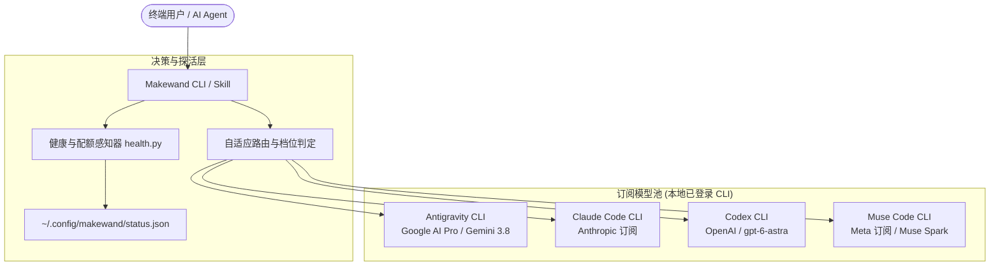

# Makewand (魔杖) v4.0.0

> **多模型编程订阅联合调度与红队自愈体系** (Unified Multi-Model Subscription Orchestrator)  
> 官方网站：[https://makewand.org](https://makewand.org) · 备用镜像：[https://makewand.com](https://makewand.com)  
> 统合调用本机 **Antigravity (Google AI Pro)**、**Claude Code**、**Codex CLI (OpenAI)**、**Grok Build**、**Muse Code** 与其他已配置工具，提供订阅优先调度、显式付费 API 策略、跨模型审查、自愈回环与候选比较。

```bash
# 🚀 官方一键快速安装
curl -fsSL https://makewand.org/install.sh | bash
```

> **维护模式（2026-10-24 起）**：不再增加功能，只做正确性、安全、恢复与兼容修复。Go 的 TUI、server 套件、引擎与路由、原生发行包和 Windows 门禁已于 2026-11-05 从主线移除，保留在 tag `archive/pre-trim-20261105`；本仓库的 Go 只剩 `makewand-server quota`。安装请用源码：`scripts/install.sh`。

---

## 🌟 核心特性 (Key Features)

- **🌐 官方网站与文档中心**：托管于 Cloudflare Pages 全球边缘网络（[makewand.org](https://makewand.org) / [makewand.com](https://makewand.com)），提供交互式终端模拟器与完整手册。
- **🔌 全生态工具自适应拓扑**：根据已安装工具、显式启用配置和健康缓存选择实现与审查引擎。只有一个工具时使用单独的只读复审调用，仍需测试及有效裁决。
- **💰 明确的 API 费用策略**：默认 `subscription_only`，禁止 Makewand 直接调用云 API，即使环境中已有 API key 也不会自动转为付费回退。设置 `MAKEWAND_API_POLICY=allow_paid` 或配置 `"api_policy": "allow_paid"` 才允许按量计费的 API 与回退；订阅 CLI 限额、登录失效或未安装时，也只有在 `allow_paid` 下才转用已配置的 API key，否则这类引擎不算可用。`makewand status` 展示当前策略。官方 CLI 自身的计费模式、订阅配额和本机资源消耗仍由相应工具及配置决定。
- **⚡ 额度感知与自适应降级 (Quota-Aware Routing)**：
  - 额度按当前账号、模型和实际窗口处理；Codex 支持官方只读额度查询。缺少官方读数时显示未知，本地调用计数不换算成订阅余量。
  - 限额与登录失效只依据各 CLI 自己打印的消息判定（`makewand/cli_message_catalog.json`，Go 路由器内嵌同一份），模型回答、工具输出或提示回显中的相同字样不算。
  - 在已启用且可用的候选引擎间回退；额度、认证或审查失败可能阻止交付。
- **🛡️ 跨模型独立红队审查 (Cross-Model Review)**：
  - 审查在只读沙箱中运行，优先采用与实现者不同的引擎。
  - 审查必须给出结构化 `MAKEWAND_VERDICT`，并与经过测试的具体产物绑定。
- **🚀 无头执行与跨平台沙箱约束**：写入任务在必需的 Bubblewrap (bwrap) 沙箱内运行官方 CLI；沙箱不可用时遵循 fail-closed 拒绝执行。bwrap 沙箱依赖 Linux 内核命名空间。没有沙箱时（如 macOS），**包括只读审查 `makewand review` 在内的所有 provider 调用**都需要显式配置 `MAKEWAND_UNSAFE_HOST_EXEC=1` 并完成一次交互确认（所有宿主执行审计至 `unsafe_exec_audit.jsonl`），或改在装有 bwrap 的 Linux 容器/虚拟机中运行。Go 的 Strength1 候选仍需人工确认。
- **📡 实时流式输出**：支持 `--stream` 参数，带模型专属色彩前缀逐行流式呈现。

---

## 🏗️ 架构拓扑 (Architecture)



---

## 📦 安装与配置 (Installation)

### 快速安装
```bash
cd path/to/makewand
./scripts/install.sh
```
源码安装需要 Git、Python 3.9+ 和 `go.mod` 指定的 Go 工具链。安装器冻结 Go/Python 构建输入，在独立版本目录中编译、检查版本及公共命令，然后原子切换 `current` 与 `~/.local/bin/makewand`。失败保留原安装，并保留 `previous` 供回退；同时建立兼容的 `trio` 软链接。安装目录（默认 `~/.local/bin`，可用 `MAKEWAND_BIN_DIR` 指定）不在 `PATH` 中，或 `PATH` 上更早的位置有另一个 `makewand` 时，安装器最后会打印需要加入 shell 配置（如 `~/.zshrc`、`~/.bashrc`）的 `export PATH=...` 行，加入后打开新终端即可。

供应商启停策略对 Go/Python 入口共同生效，禁用也阻止该工具的探测和额度读取。Claude、Gemini 和 OpenAI 的 API 参数按环境变量、`api_keys.json`、`config.json`、默认值的顺序读取；付费调用仍需显式启用 `allow_paid`。详见[共享配置契约](docs/EXECUTION_CONTRACT.md#shared-provider-configuration)。

代理默认值对 Go/Python 的 provider CLI、沙箱和 API 路由共同生效。编辑 `~/.config/makewand/config.json`（或 `MAKEWAND_CONFIG_DIR/config.json`），保留其他配置，例如：

```json
{"proxy": {"default": "http://proxy.example:8080", "no_proxy": "localhost,127.0.0.1,.internal.example"}}
```

`MAKEWAND_DEFAULT_PROXY`、`MAKEWAND_DEFAULT_NO_PROXY` 分别覆盖这两个字段，空字符串可禁用相应默认值。仅当调用方完全没有 `HTTP_PROXY`、`HTTPS_PROXY`、`ALL_PROXY` 及其小写变量时，才补齐六个代理变量；已有变量（包括空值）原样保留。仅在补默认代理时，且调用方没有任一大小写 `NO_PROXY`，才补齐 `NO_PROXY`/`no_proxy`。没有配置默认代理时不加代理，也没有内置本机端口。离线沙箱不补默认代理。

Gemini/agy 默认遵循代理，只有显式设置 `MAKEWAND_GEMINI_BYPASS_PROXY=1` 才向大小写 `NO_PROXY` 追加 Google 域名；兼容开关 `MAKEWAND_GEMINI_USE_PROXY=1` 优先于绕过开关。Google API 路由也遵循此规则。`makewand status`（含 `--json`）显示代理来源：环境变量、配置默认值或无；状态只显示来源，不输出代理 URL，避免泄露用户名密码。Go 入口的 `setup` 同样显示来源。默认值不会写入宿主环境或配置文件。

`MAKEWAND_QUOTA_RESERVE_PERCENT` 设置官方剩余额度的保留阈值，默认 `8`（百分比）；例如仅对一次命令设置 `MAKEWAND_QUOTA_RESERVE_PERCENT=4 makewand ...`。只接受有限数值 `0`–`100`，低于阈值时阻止自动派发；`0` 也不会放行已耗尽额度。无效设置会显示警告并回退到 `8`，不会清除实际限流或认证失败；账号关联及官方数据有效期仍照常校验。显式设置时，Codex 精确的剩余百分比使用同一阈值；模糊的低额度警告只有新鲜、同账号官方证据确认足够时才放行，真实限流仍优先。该设置不增加订阅额度，也不启用付费 API。

---

## 💻 命令行用法速查 (CLI Reference)

### 1. 订阅健康状态与额度看板
```bash
# 查看健康缓存与额度来源（不会主动调用模型）
makewand status
makewand quota

# 显式发起探活（claude/codex/muse/grok 消耗真实订阅调用；agy 只在有未过期的失败记录或额度限制时做一次真实调用）
makewand probe
```

已启用的引擎都处于错误状态，或处于限额、需重新登录、未安装且没有 API 策略允许转用的 API key 时（默认的 `subscription_only` 下 key 从不转用），任何任务都不派发，并逐个列出原因（退出码 11）。用 `--provider X` 指定的引擎在工作区准备与任何派发之前先检查：不可用时同样不派发（退出码 11，`Requested engine X is not usable: <原因>`）；可用时即使其他引擎都不可用也会运行，审查请求则只由它审查。

### 2. 动态模型发现
```bash
# 自动探测系统配置文件中记录的最新模型版本
makewand models
```

### 3. 独立代码审查
```bash
# 针对当前目录未提交的 git diff 实施红队安全审查
makewand review
```

审查 diff 超过 256 KiB（用 `MAKEWAND_REVIEW_DIFF_MAX_BYTES` 调整，单位字节）时不做截断审查，结论为未验证（退出码 11），完整补丁保存为可直接 `git apply` 的 `unverified.patch`。超过 31 KiB 的审查提示不交给 agy（它只能分页读取提示文件），流水线改由下一位可用的审查方接替；cursor、copilot 等占位引擎从不审查；本地模型的只读回答须由 token 计数证明读到了完整提示，否则为未验证。详见 [执行约定](docs/EXECUTION_CONTRACT.md#reviewer-capacity)。

### 4. 带预算安全搜索 (避免冷归档与大库 I/O 卡死)
```bash
makewand search "def safe_search" --cwd /path/to/project
```

### 5. Bubblewrap 物理进程沙箱隔离执行
```bash
# 隔离运行单元测试 (只读根目录、凭据自动脱敏、仅工作区可写)
makewand sandbox python3 -m pytest tests/

# 阻断外网访问执行构建/测试
makewand sandbox --no-net go test ./...
```
> **跨平台隔离说明**：Bubblewrap 物理沙箱依赖 Linux 内核命名空间。没有沙箱时（如 macOS），所有 provider 调用（包括只读审查）都遵循 fail-closed 拦截，并给出指引：在装有 bwrap 的 Linux 容器/虚拟机中运行，或显式 `MAKEWAND_UNSAFE_HOST_EXEC=1` 确认授权（附审计记录）。bwrap 只从 root 拥有的系统目录解析，装在其他位置时用 `MAKEWAND_BWRAP_PATH` 指定。

> **依赖安装网络**：Go 候选验证中只有“下载”走网络（站主 2026-10-21 定）。依赖步骤拆成两段：不执行项目代码的取回（`pip download --only-binary=:all:`；按 makewand 先解析并检查过、只含注册表包的锁文件进行的 `npm ci --ignore-scripts`，命令行带包参数时不联网；固定到具名 rustup 工具链的 `cargo fetch`；`go mod download`/`tidy`）在工作区之外、每次新建且只含清单与锁文件副本的私有取回目录中联网运行，看不到工作区的任何文件，只运行工作区之外的可信工具，下载到宿主自有的共享缓存（之后的回环步骤只读）；随后的构建/安装（`pip install --no-index --find-links`、含 `-e .`；`cargo build --offline`）只在回环网络下进行——`setup.py`/`build.rs`/生命周期脚本永不在可联网时运行，`node_modules` 与锁文件由宿主在取回后放入工作区。取回找到可信的 `slirp4netns`、`nsenter`、`ip` 时只能访问公网（私网、回环、链路本地与云元数据、组播及本机地址在命令运行前即被路由屏蔽，可选的 `tc`/`nft` 再过滤组播与 IPv6），否则只有回环网络；这些工具不在 root 拥有的系统目录时，用 `MAKEWAND_SLIRP4NETNS_PATH`、`MAKEWAND_NSENTER_PATH`、`MAKEWAND_IP_PATH`、`MAKEWAND_TC_PATH`、`MAKEWAND_NFT_PATH` 指定。取回不绑定宿主模块缓存；pip 配置与需求文件指定的私有索引照样使用，绝不被 PyPI 悄悄替换。无法在不运行代码的前提下取回的依赖（索引显示匹配版本只有源码分发、需构建的 git 依赖、npm 的 git/本地/workspace 依赖、以路径指定的 Rust 工具链等）按环境问题（依赖不可用）报告、不扣分；不存在的项目或版本仍算候选失败。私网或本机回环上的镜像与代理按设计不可达。安装失败只有在 makewand 自己的连通性检查（离线时为项目文件）确认注册表不可达时才算环境问题，此时 TUI 跳过测试、不扣分。详见 [SECURITY.md](SECURITY.md#dependency-installs--依赖安装)。

### 6. 单模型直接透传调用
```bash
makewand agy "总结当前项目的架构优势"
makewand codex "分析这段代码的死锁风险"
makewand claude "编写测试用例"
makewand muse "检查系统配置项"
```

### 7. 自动派活选型：route / mark / outcome

```bash
# 为子任务挑选工具、模型与推理深度，打印可照抄的派活命令（只读本地缓存与成绩账本，不调用模型）
makewand route implement normal --self claude
makewand route review hard --self claude --not codex --json

# 派活遇到 429 或额度用完：标记该工具，到期前 route 跳过它
makewand mark codex 6h --reason 429

# 验收后记录成绩，route 据此调整之后的排序
makewand outcome codex 2 implement pass --model gpt-6-astra --effort high
```

`route <类型> <难度>` 的类型为 review、implement、test、research、doc，难度为 mechanical、normal、hard。它在完整的模型 × 推理深度目录中，从够用的最便宜档位（1–3）起选：跳过 `~/.config/mw-hub/policy`（或 `MW_HUB_POLICY`）里暂停中的工具、`mark` 标记期内的工具，以及官方周额度达到阈值的 codex/claude（默认 90%/85%），再按 `outcome` 记录的通过率用 Thompson 采样排序。`--self <工具>` 把与你同家的候选排在最后，`--not <工具>` 排除与它同家族的候选（审查时传实现方），`--tier N` 指定起始档，`--risk high` 从最强档起，`--simple` 只用精简三档表，`--json` 输出全部候选；验收不过时按输出末尾的提示升一档。派活命令自带的时限见下文“调用与资源预算”。

`route` 和 Python 订阅 CLI 启动还共用当前账号/模型的额度检查：真实拒绝记录与官方各时间窗口分别保留，默认剩余额度保护值仍为 8%，周阈值仍为上述 90%/85%。模型子限额只影响相应模型，AGY 的 Gemini 限流不会推断为 Opus/Sonnet 没额度；`mark` 仍是用户明确设置的整工具暂停。Codex 通过只读 `account/rateLimits/read` 查询实际窗口，不发送生成请求；未知桶不会冒充模型或共享额度。Go 原生路由的 70%/90% 档位仍用于软排序，与操作方设置的启动保护阈值含义不同。未观察到额度、身份或重置后新状态时显示未知；本地削峰与并发保护继续独立生效。

`mark <工具> <时长>` 的时长为 d/h/m/s 组合（如 `6h`、`93h17m`、`2d`，最长 365 天），`--reason` 可选。`outcome <工具> <档> <类型> pass|fail` 可附 `--model`、`--effort`、`--seconds`、`--calls`。标记与成绩保存在 makewand 私有状态目录的 `routing/` 下（`MAKEWAND_ROUTING_DIR` 可改）。三个命令都不调用模型；在 provider worker（`MAKEWAND_PROVIDER_WORKER=1`）内被拒绝。

记录成绩时沿用派发的 `--request-id` 和发起工具 `--caller`（或继承 `MAKEWAND_TASK_ID` / `MAKEWAND_CALLER`）。新 shell 未携带请求 ID 时，只在同项目、同提供者和模型下存在唯一近期未验收调用时自动关联；歧义不会靠猜测消除。审查工作的 `pass|fail` 与候选裁决分开：用 `--candidate-verdict pass|fail|unverified`、实测 `--seconds` 和实际 `--calls` 记录裁决；新批准还必须有 `--candidate-hash <完整候选的SHA256>` 和可关联的请求 ID。缺这些数据时仍可仅记录工作质量，不能记为候选批准。旧记录保持可读，不补写未知的 ID 或哈希。

`makewand observe` 会提示超过默认上限的请求及 UNKNOWN/超时后的后续调用，供核对授权；这些提示本身不证明违规。未分类 CLI 失败的脱敏诊断保存在用户缓存 `makewand/unclassified-cli-failures.jsonl`：仅保留已知 CLI 自身独立 stderr 的末尾，不收集模型回答或 Codex 会话内容，文件有容量上限；诊断写入失败不影响调用结果。

### 调用与资源预算

`--max-model-calls` 按 Makewand 派发任务计数。官方 CLI 在一次派发内可能进行多轮内部模型调用，这些内部调用不计入。

```bash
makewand codex --model gpt-6-astra --effort medium -C <目录> -f <任务文件> --readonly \
  --request-id <请求ID> --caller claude --max-model-calls 3 --timeout 1800 --total-timeout 1800
```

带 `--request-id` 时默认上限 3 次；同一请求 ID 跨会话、跨工具共用计数。`makewand budget request --request-id <ID> --json` 查看用量，用户明确同意后用 `--set-limit` 调整。

`makewand route <类型> <难度> --self <你>` 输出的命令已带好时限和 `--readonly`；Codex 审查默认 1800 秒，其他审查按难度 900/1800/5400 秒。`route` 和 `status` 会在 Codex、Claude 周额度按目前速度来不及撑到重置时给出预计到线时间。

设置 `MAKEWAND_EXECUTION_EVENTS_FILE=/tmp/task-events.jsonl` 可记录执行事件。

---

## 🤖 主流 AI 协同接入 (AI Integrations)

Makewand 原生设计为不仅面向人类终端开发者，更作为所有 AI 代理的“外挂魔杖”：
- **Antigravity (AGY)**：推荐作为调用中心，安装 `makewand-orchestrator` skill；skill 规定只有用户明确要求时才运行 `run`/`race`/`ensemble`，高风险改动可主动运行只读 `review`。
- **Claude Code**：在 `CLAUDE.md` 中加入简短说明，用户明确要求时运行 `makewand review` 做跨模型审查。
- **Codex CLI**：在 `AGENTS.md` 中加入同样的简短说明。
- 被 makewand 派发的 CLI 带有 `MAKEWAND_PROVIDER_WORKER=1`，不能再调用 makewand，嵌套调用不会递归。
- **Muse Code**：支持在 Meta 生态中联动调度其它模型。

详细指引见 [integrations/](integrations/) 目录。

---

## 🧪 自动化测试 (Testing)

```bash
make test
# 只跑 Python 测试（CI 的同一条命令；需要能被 python3 -I 导入的 pytest）
python3 -I -m pytest -q -p no:cacheprovider tests
```

部分测试模块只有模块级的 pytest 测试函数，unittest 收集不到：`python3 -m unittest discover tests` 会静默跳过它们；只依赖标准库的 `scripts/test_python.py` 遇到这类模块会列出并以失败退出，不会静默通过。
